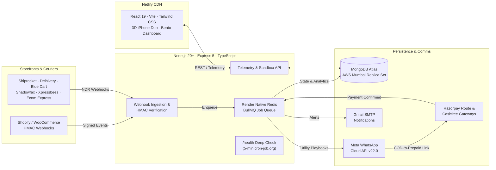

<div align="center">

# 🚢 RescueShip

### Autonomous COD RTO Recovery & Sub-90s NDR Interception Engine for D2C E-Commerce

[](https://rescueship.netlify.app)
[](https://rescueship.onrender.com)
[](#testing--quality-engineering)
[](#integrations-matrix)

[](#tech-stack)
[](#tech-stack)
[](#tech-stack)
[](#tech-stack)
[](#tech-stack)
[](#tech-stack)
[](#testing--quality-engineering)

**[Launch Live Interactive Showcase →](https://rescueship.netlify.app)** · **[Full-Stack API Mirror →](https://rescueship.onrender.com)** · **[Health Probe (`/health`) →](https://rescueship.onrender.com/health)**

</div>

---

## ⚡ Executive Summary

Return-to-Origin (RTO) on Cash-on-Delivery (COD) shipments costs Indian D2C brands **₹200–₹400 per failed order** across forward/reverse freight, payment leakage, and locked inventory.

**RescueShip** replaces manual call centers and delayed carrier batch spreadsheets with an **autonomous, sub-90-second event-driven interception engine**:

| Metric / Capability | Production Benchmark |
| :--- | :--- |
| **Interception Latency** | **Sub-90s** automated courier NDR detection-to-WhatsApp dispatch loop |
| **RTO Cost Prevention** | **₹200–₹400** saved per recovered COD shipment (₹140 direct freight + inventory CAC) |
| **Test Verification** | **539 passing tests** across **62 suites** (Jest + Playwright Visual Regression + A11y) |
| **Messaging Engine** | Official **Meta WhatsApp Cloud API v22.0** utility playbooks |
| **Infrastructure** | **MongoDB Atlas (AWS Mumbai)** + **Render Native Redis / BullMQ** + **5-min `/health` keepalive** |
| **Payment Gateways** | Dual-mode **Razorpay Route** (managed SMB settlement) & **Cashfree** direct gateway |

---

## 📱 Flagship Interactive Showcase

RescueShip pairs its production backend with an interactive product showcase designed for instant evaluation without signup friction:

* **3D Canvas iPhone Duo Foldable Hardware Simulation** — Real-time WebGL/Three.js dual-screen foldable hardware experience visualizing buyer WhatsApp NDR resolution alongside real-time merchant telemetry.
* **Bento Finance Dashboard** — Dynamic telemetry visualization of COD-to-Prepaid conversions, RTO loss prevention, carrier SLA compliance, and net yield metrics.
* **Scrollytelling NDR Timeline** — 4-step elastic narrative walkthrough of the sub-90-second interception lifecycle from courier webhook ingestion to re-attempt dispatch.
* **Sandbox API & Telemetry Engine** — Interactive mockups and test NDR dispatchers (`POST /api/templates/test-send`, `POST /api/templates/sync-meta`) for live simulation.

---

## 🏗️ System Architecture



---

## 📊 Competitive Positioning

| Dimension | Legacy Aggregators (ClickPost / Shipway) | **RescueShip** |
| :--- | :--- | :--- |
| **Primary Workflow** | Post-hoc tracking pages & batch NDR queues | **Sub-90s real-time webhook-to-WhatsApp interception** |
| **COD Recovery** | Passive reminder SMS / basic WhatsApp text | **Native Razorpay Route & Cashfree COD-to-Prepaid dynamic discount links** |
| **Queue Architecture** | Polling / tightly coupled cron jobs | **BullMQ on Render Native Redis** for isolated retries, concurrency & backoff |
| **Data Residency** | Multi-region / opaque latency | **MongoDB Atlas AWS Mumbai (`ap-south-1`) replica set** for low-latency Indian ops |
| **Anti-Exploitation** | Unchecked free coupon handouts | **Phone hashing cooldown (3 strikes/30d)** & payment-gated transit reversal |
| **Verification** | Manual spot-checks | **525 tests / 61 suites** (Jest + Playwright visual & a11y gates) |

---

## 🚚 Multi-Carrier Logistics Hub & Supported Providers

RescueShip integrates out-of-the-box with India's top 8 logistics networks and aggregators, supporting unified NDR interception, automated reattempt scheduling, dynamic address corrections, and RTO arrest across all providers:

| Logistics Partner | Ingestion Webhook | Action Dispatching | Integration Modes |
| :--- | :--- | :--- | :--- |
| **Shiprocket** | `/webhooks/shiprocket/ndr` | Reattempt / address change (`/ndr/reattempt`), return (`/ndr/{awb}/action`) | Direct API & Webhook-Only |
| **Delhivery** | `/webhooks/delhivery/ndr` | Waypoint Reattempt Slotting, Address Update API | Direct API & Webhook-Only |
| **Blue Dart Express (DHL)** | `/webhooks/bluedart/ndr` | Waybill Rescheduling, Consignee Remarks Sync | Direct API & Webhook-Only |
| **Xpressbees** | `/webhooks/xpressbees/ndr` | Real-Time Reattempt Dispatch, Street/Pin Rectification | Direct API & Webhook-Only |
| **Shadowfax** | `/webhooks/shadowfax/ndr` | Doorstep Slot Reschedule, RTO Cancellation Halt | Direct API & Webhook-Only |
| **Ecom Express** | `/webhooks/ecomexpress/ndr` | Field Remark Parsing, Reattempt Instruction Dispatch | Direct API & Webhook-Only |
| **DTDC** | `/webhooks/dtdc/ndr` | Consignment Tracking, Address Amendment Sync | Direct API & Webhook-Only |
| **ClickPost** | `/webhooks/clickpost/ndr` | Logistics Intelligence Parsing, Reattempt Dispatch | Direct API & Webhook-Only |
| **Custom / Aggregators** | `/webhooks/custom/ndr` | Universal Payload Ingestion (NimbusPost, Shipway, Shyplite, Private Fleets) | Webhook-Only & Universal API |

### Dual Integration Modes

1. **⚡ Direct API Integration**: Merchants supply carrier API credentials; RescueShip automatically dispatches customer reschedule selections, corrected GPS addresses, and RTO arrest instructions directly into the carrier operations portal in real-time.
2. **🔗 Webhook-Only Mode**: **Zero carrier API keys required**. Merchants point their carrier NDR webhooks to:
   ```
   https://rescueship.onrender.com/webhooks/{provider}/ndr?merchant_id={merchantId}
   ```
   RescueShip intercepts failures, resolves friction over WhatsApp, and updates the merchant dashboard seamlessly.

---

## 📲 Approved Meta WhatsApp Utility Templates

All customer-facing WhatsApp interactions utilize pre-approved **UTILITY** templates under Meta Business Manager (v22.0 Cloud API):

| Template Identifier | Category | Purpose | Customer Action Buttons |
| :--- | :---: | :--- | :--- |
| **`ndr_reschedule_en`** | UTILITY | Intercepts "Customer Unavailable" and "Premises Locked" remarks. | `I'm Home Now`, `Reschedule`, `Cancel Order` |
| **`ndr_address_en`** | UTILITY | Disambiguates missing house numbers, landmarks, and street pins. | `Share GPS Pin`, `Type Landmark`, `Cancel Order` |
| **`ndr_cod_convert_en`** | UTILITY | Doorstep conversion when customer lacks exact cash change. | `Pay via UPI`, `Reschedule with Cash`, `Cancel Order` |
| **`ndr_retention_en`** | UTILITY | High-urgency RTO arrest & cancellation interception. | `Pay via UPI`, `Confirm Cancel` |

### Multi-Step Interactive Workflows:
1. **Reschedule Sub-Tree**: Customer chooses between `Tomorrow`, `Day After Tomorrow`, or `This Weekend`. The selected ISO date is committed to the courier's reattempt scheduler.
2. **2-Step Address Flow**:
   - **Step 1**: Customer drops a live WhatsApp location pin (reverse geocoded via OpenStreetMap Nominatim with $\pm 4$m precision) or sends colloquial text instructions.
   - **Step 2**: Gemini AI NLP extracts landmarks and prompts for building/floor details. Coordinates and notes are merged and injected into the courier driver app.

---

## 🛡️ Anti-Exploitation & Unit Economics Engine

RescueShip is built on strict logistics unit economics—**never** on unbacked marketing gimmicks:

1. **Self-Funding COD-to-Prepaid Retention**:
   - Indian couriers charge **₹80 to ₹140 per parcel** as cash-handling charges (COD surcharges).
   - Offering a **5% retention discount** (capped at ₹100) upon payment conversion is **100% self-funded** by the courier fee savings.
   - Already-prepaid orders never receive discounts upon cancellation requests.
2. **Anti-Farming Cancellation Cooldown**:
   - Repeat abusers are tracked via SHA-256 phone number hashing.
   - Customers with **$\ge 3$ cancellations or RTOs in 30 days** are denied promotional retention and routed to immediate cancellation.
3. **Payment-Gated Transit Reversal**:
   - In high-urgency RTO situations, transit reversal is **strictly gated on a verified payment capture webhook** from Razorpay or Cashfree.
   - Tapping a button alone does **not** halt transit; only captured funds instruct the carrier line-haul API to halt reverse shipment.
4. **Universal Order Ingestion & Missing Phone Recovery**:
   - Indian couriers frequently omit customer phone numbers in NDR payloads.
   - RescueShip ingests all orders upon creation (`status: 'new'`) from Shopify/WooCommerce, enabling 100% phone linkage via AWB reconciliation.
5. **Courier Remark Sanitization**:
   - Delivery executives often mark "Cash not ready" on parcels already paid online.
   - RescueShip detects prepaid status and automatically shifts the workflow from COD collection to delivery rescheduling (`ndr_reschedule_en`).

---

## 🔒 Subsystem Architecture & Multi-Tenancy Fast Index

Modifications to this codebase adhere to strict isolation invariants:

| Subsystem | Primary Code Location | Multi-Tenant Isolation & Security Invariant |
| :--- | :--- | :--- |
| **Settings & Discounts** | [`src/api/settings.api.ts`](src/api/settings.api.ts) | Extracts `merchantId` solely from verified JWT (`req.merchant.merchantId`). Mutates only `Merchant.findById(merchantId)`. |
| **Credentials Vault** | [`src/models/Merchant.ts`](src/models/Merchant.ts)<br>[`src/services/encryption.service.ts`](src/services/encryption.service.ts) | Encrypted at rest via **AES-256-GCM**. Redacted as `********` via `toSettingsDto()` on GET. |
| **Phone Collision Guard** | [`src/api/settings.api.ts`](src/api/settings.api.ts) | Checks `Merchant.findOne({ _id: { $ne: merchant._id }, 'whatsappConfig.phoneNumberId' })` -> throws **409 Conflict**. |
| **COD Conversion Logic** | [`src/services/order.service.ts`](src/services/order.service.ts) | Evaluates discounts strictly using `merchant.settings.codConversion` of the owning store. Zero cross-tenant leakage. |
| **Outbound WhatsApp** | [`src/services/whatsapp.service.ts`](src/services/whatsapp.service.ts)<br>[`src/services/whatsapp/whatsapp-dispatcher.service.ts`](src/services/whatsapp/whatsapp-dispatcher.service.ts) | Dual routing: Uses custom merchant WABA if provided; falls back to RescueShip's verified logistics WABA for SMBs. |
| **Inbound WhatsApp** | [`src/webhooks/whatsapp.webhook.ts`](src/webhooks/whatsapp.webhook.ts) | Resolves merchant from `metadata.phone_number_id` sent by Meta; scopes all message logs to that tenant. |
| **Store Webhooks** | [`src/webhooks/shopify.webhook.ts`](src/webhooks/shopify.webhook.ts)<br>[`src/webhooks/woocommerce.webhook.ts`](src/webhooks/woocommerce.webhook.ts) | Shopify derives tenant from signed shop domain. WooCommerce verifies per-merchant HMAC with `merchant_id`. |
| **Payment Webhooks** | [`src/webhooks/razorpay.webhook.ts`](src/webhooks/razorpay.webhook.ts)<br>[`src/webhooks/cashfree.webhook.ts`](src/webhooks/cashfree.webhook.ts) | Resolves merchant via `paymentLinkId`, validates signature, records immutable ledger entry, and executes Razorpay Route. |
| **Settlement Ledger** | [`src/models/MerchantTransaction.ts`](src/models/MerchantTransaction.ts)<br>[`src/api/transactions.api.ts`](src/api/transactions.api.ts) | Queries strictly isolated by authenticated `merchantId`. Immutable tracking of collections, ~2.65% fees, and net payouts. |
| **Orders & Dispute Chats** | [`src/api/orders.api.ts`](src/api/orders.api.ts) | `Order.find({ merchantId })` & `MessageLog.find({ merchantId })`. Cross-tenant queries return 404. |

---

## 🛠️ Tech Stack

* **Frontend:** React 19, Vite, Tailwind CSS, Motion for React, Three.js (3D Foldable Rig), Recharts, Lucide Icons
* **Backend:** Node.js 20+, Express 5, TypeScript 6
* **Database & Queues:** MongoDB Atlas (AWS Mumbai Replica Set), Redis (ioredis), BullMQ
* **Communications:** Meta WhatsApp Cloud API v22.0, Gmail SMTP
* **Payment Gateways:** Razorpay Route, Cashfree
* **Testing:** Jest 30, Playwright 1.62 (Visual Regression & A11y), Vitest
* **Deployment & Monitoring:** Netlify (Primary Frontend CDN), Render (Full-Stack & Native Redis), `cron-job.org` (`/health` Keepalive)

---

## 🧪 Testing & Quality Engineering

RescueShip enforces strict automated verification across logic, UI rendering, and accessibility:

* **539 passing tests** across **62 test suites**
* **Jest:** Comprehensive unit and integration verification for core workflows, webhook handling, and queue logic:
  ```bash
  npm test
  ```
* **Playwright:** Cross-viewport visual regression checks and automated accessibility (`a11y`) validation:
  ```bash
  cd frontend
  npm run test:e2e
  ```

---

## 🚀 Quickstart (Local Development)

### Prerequisites
* **Node.js** `>= 20.x`
* **MongoDB** (Local instance or Atlas URI)
* **Redis** (Local instance or cloud Redis URI)

### 1. Clone & Install
```bash
git clone https://github.com/Konark-1/Rescueship.git
cd Rescueship

# Install backend dependencies
npm install

# Install frontend dependencies
cd frontend
npm install
cd ..
```

### 2. Configure Environment
Create a `.env` file in the root directory:
```env
PORT=3000
NODE_ENV=development
MONGODB_URI=mongodb://localhost:27017/rescueship
REDIS_HOST=localhost
REDIS_PORT=6379
JWT_SECRET=your_secure_32_character_jwt_secret
ENCRYPTION_KEY=your_secure_32_character_aes_encryption_key
FRONTEND_URL=http://localhost:5173

# Optional: Meta WhatsApp Cloud API Credentials
WHATSAPP_TOKEN=your_meta_system_user_token
WHATSAPP_PHONE_NUMBER_ID=your_phone_number_id
```

### 3. Run Development Servers
```bash
# Terminal 1: Backend Engine
npm run dev

# Terminal 2: Frontend App
cd frontend
npm run dev
```

* **Frontend UI:** `http://localhost:5173`
* **Backend REST API:** `http://localhost:3000`
* **Health Check:** `http://localhost:3000/health`

### 4. Zero-Key Local Simulation & Replication (Sandbox Mode)
RescueShip includes a built-in sandbox simulation suite allowing developers to trigger and evaluate end-to-end NDR interception without live Meta, Shopify, or Courier API credentials:
* **Interactive UI Simulator:** Open `http://localhost:5173/templates` to test the 5 recovery decision trees and live chat auditor.
* **Simulate NDR Webhook Ingestion:**
  ```bash
  curl -X POST http://localhost:3000/api/sandbox/simulate-ndr \
    -H "Content-Type: application/json" \
    -d '{"category": "CUSTOMER_NOT_AVAILABLE", "carrier": "delhivery"}'
  ```
* **Verify Automated Test Suite:**
  ```bash
  npm test                 # Run 539 unit & integration tests
  cd frontend && npm test  # Run frontend vitest suite
  ```

---

## 🌐 Live Production Deployments

| Service | Environment | Endpoint | Details |
| :--- | :--- | :--- | :--- |
| **Frontend Web App (Primary)** | Netlify Global CDN | [`https://rescueship.netlify.app`](https://rescueship.netlify.app) | Instant global edge delivery & SSL |
| **Backend REST API** | Render Web Service | [`https://rescueship.onrender.com`](https://rescueship.onrender.com) | Express 5 + Node.js cluster |
| **Active Keepalive** | Cron-Job.org | [`https://rescueship.onrender.com/health`](https://rescueship.onrender.com/health) | Continuous health probe every 5 mins preventing cold-starts |

---

## 📄 License

ISC License. Copyright © 2026 RescueShip Inc. All rights reserved.
