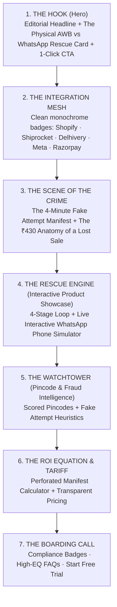

# 🎨 Neutomni Deconstruction & RescueShip Anti-AI Transformation Blueprint

> **Reference Study:** [Neutomni Studio](https://neutomni.com/)  
> **Target Platform:** RescueShip (`https://rescueship.netlify.app`)  
> **Core Objective:** Eliminate the "AI-generated clutter" and "terminal overload", while crafting an elite, minimal, story-driven, and high-impact homepage that showcases RescueShip's autonomous recovery product.

---

## 1. Executive Deconstruction: What Makes Neutomni Feel 100% Human & Elite

When you browse **[neutomni.com](https://neutomni.com/)**, it does **not** look like an AI built it. It feels alive, intentional, witty, and bespoke. Why? Because it rejects every single generative AI template cliché (bento grids, generic gradient cards, purple-on-black neon, floating 3D spheres, buzzword soup) in favor of **tactile human metaphors and editorial print craft**.

```
┌─────────────────────────────────────────────────────────────────────────────┐
│                       THE NEUTOMNI CRAFT FORMULA                            │
├─────────────────────────────────────────────────────────────────────────────┤
│  1. Physical Skeuomorphism    → Scissors, tear-lines, tickets, CRT monitor  │
│  2. Editorial Typographic CADENCE → Grotesque Sans + Delicate Italic Accents│
│  3. Interactive Visual Math    → Canvas polygon rolling over bumpy road     │
│  4. Conversational Voice      → Witty, human, humble, zero corporate fluff │
│  5. Desktop OS Metaphor       → Draggable windows, .md & .png files, pet cat│
└─────────────────────────────────────────────────────────────────────────────┘
```

### The 5 Architectural Pillars of Neutomni's Design:

### 1. Tactile Physical Skeuomorphism (Not Digital Abstraction)
- **The Scissors & Cut-Line**: A custom animated pair of scissors actively cutting across a dashed line (`--- ✂ --- [ cut along line ]`) that tracks scroll progress.
- **Physical Ticket Backings**: Service pricing cards flip like real cardboard package tags with barcodes, QR codes, serial numbers (`NEU/PKG.01-E1`), and playful warnings: *"CREATIVE MATERIAL, DO NOT RECYCLE!"*.
- **The Barcode Scanner CTA**: Instead of a generic `[ Get Started ]` button, the CTA is a stylized barcode that animates on hover with a laser scan effect.
- **Physical Drag-to-Morph Track**: An SVG that morphs through geometric stages (diamond → hexagon → octagon → circle) as you drag a physical slider or hover over "[ Let's talk ]".

### 2. Editorial Typographic Cadence
- They **never** write a sentence in monotone text.
- Every major headline pairs a strong, modern grotesque sans-serif with an **unexpected, elegant italic accent** on the emotional word:
  - *"We build websites for people who care <span class="italic">as much as we do</span>"*
  - *"Your website isn't an expensive decoration. <span class="italic">It's the sharpest point of your digital presence.</span>"*
  - *"The road can get <span class="italic">bumpy</span>. We keep you <span class="italic">rolling</span> regardless."*
- This rhythm instantly breaks the mechanical cadence of LLM-generated copy.

### 3. Purposeful, Story-Driven Motion (Canvas Math)
- Instead of generic CSS float animations, Neutomni uses an HTML5 Canvas script where a mathematical shape (4-sided polygon morphing into a 12-sided circle) **rolls smoothly along catenary arches** across the screen as you scroll.
- The motion **is the story**: it visually proves that no matter how bumpy the road is, their wheel keeps rolling smoothly.

### 4. Interactive Desktop OS & Relatable Personality
- In the pricing and FAQ section, they render a **vintage CRT desktop interface** (with classic Windows XP Bliss wallpaper, draggable windows, and desktop icons):
  - `Pricing.html`
  - `FAQ.md` rendered inside an authentic syntax-highlighted code editor window with line numbers
  - `Zefir.png` — a photo of their cat labeled "Office Manager"
  - `Natalia.png` & `Andrii.png` — real candid team photos
  - `Testimonials` in a realistic messaging chat tab
- This gives visitors an intimate, memorable peek into the real human beings behind the craft.

### 5. High-EQ, Conversational Copywriting
- **Cookie Banner**: *"Who would’ve thought? <span class="italic">We use cookies.</span>"*
- **Contact Section**: *"Treat it like <span class="italic">a first date</span>. We’ll get to know each other better, with <span class="italic">no obligations</span>. No worries, the check is on us."*
- **Client Strategy**: *"The dislike list is often more useful than the inspiration board."*
- **Pricing Tag**: *"Ideas are not recyclable"*, *"100% original and human-made"*.

---

## 2. The Diagnosis: Why RescueShip Currently Looks "AI-Generated & Messed Up"

Comparing RescueShip's current codebase (`LandingPage.tsx`) against Neutomni reveals the exact reasons for the visual clutter:

| Feature / Element | RescueShip Currently | Neutomni Standard | What Went Wrong in RescueShip |
|---|---|---|---|
| **Visual Metaphor** | Hacker terminal, CRT scanlines, green/red dot logs | Physical package tickets, scissors, delivery manifests, desktop OS | Looks like an obscure developer script or cyber-tool rather than a high-end logistics SaaS for Shopify merchants. |
| **Number of Code Terminals** | **Three** separate simulated monospace log windows (Boot screen, Hero feed, Courier log) | **One** contextual code window (FAQ.md) framed inside a nostalgic desktop OS | Visual overload. Monospace text everywhere makes the page unreadable and monotonous. |
| **Hero Viewport** | Cluttered with an auto-scrolling terminal + live GMV ticker + 3-field input form | Spacious, bold typography with a single confident statement and ambient video/visual | Visitor feels overwhelmed with inputs and moving numbers before knowing what the product actually is. |
| **Story Arc** | Repeated **5 times** (Hero terminal, Kanban board, Cost breakdown, Accountability log, Scroll reel) | Told **once**, progressively through clear stages (Discovery → Iterations → Build → Support) | Diluted emotional punch. Seeing the courier lie repeated 5 times causes severe scroll fatigue. |
| **Product Representation** | Raw JSON-style logs (`› connecting courier webhooks`) | Realistic UI preview + authentic human testimonials | Visitors don't see what the actual software looks like in production. |
| **Scroll Experience** | Scroll-jacked 8-beat timeline with an emoji parcel `📦` | Natural smooth scroll with subtle SVG morphing | Hijacking scroll pace on desktop frustrates users and breaks on mobile. |

---

## 3. The Transformation: Translating Neutomni's Craft to RescueShip

We don't want to copy Neutomni's Webflow studio aesthetic directly (RescueShip is an automated logistics SaaS, not a design agency). Instead, we apply **Neutomni's design philosophy** to Indian e-commerce logistics:

### Replace the "Hacker Terminal" with "Tactile Logistics & Consignment Craft"

In Indian e-commerce, the real world of shipping is made of **Airway Bills (AWBs), driver delivery sheets, consignment tags, WhatsApp chats, and official rubber stamps**.

```
┌─────────────────────────────────────────────────────────────────────────────┐
│                    TACTILE LOGISTICS METAPHORS FOR RESCUESHIP               │
├─────────────────────────────────────────────────────────────────────────────┤
│  • The Failed Delivery Tag     → Red dashed border, "Premises Closed" slip │
│  • The Rubber Stamp            → Bold red "[ FAKE ATTEMPT DETECTED ]" stamp │
│  • The Recovered Manifest      → Clean emerald stamp "[ RESCUED & DELIVERED]"│
│  • The Live WhatsApp Bubble    → Authentic iOS/Android glassmorphic bubble  │
│  • The Scissors / Perforation  → Perforated receipt edge on ROI breakdown   │
│  • The Barcode Scanner         → Interactive AWB barcode for trial launch   │
└─────────────────────────────────────────────────────────────────────────────┘
```

---

## 4. The Minimal, Impactful 7-Section Architecture

Here is the exact page structure that eliminates clutter, preserves your visceral storytelling, and puts your product on a pedestal:



---

### Section-by-Section Design Blueprint

### Section 1: The Hook (Hero)
* **Eliminate**: The 1.6s terminal boot screen (`lp-boot`) and the 3-field input form.
* **Layout**: Generous whitespace, asymmetric 2-column editorial hero.
* **Left Column (The Copy)**:
  - *Eyebrow*: `AUTONOMOUS NDR RESCUE FOR INDIAN D2C`
  - *H1 Headline*:
    > Stop losing 30% of your COD orders to <span class="italic-accent">couriers who never knocked.</span>
  - *Subtext*:
    > When a delivery agent logs a fake attempt, RescueShip intercepts within 90 seconds. We ping the customer on WhatsApp, capture their live GPS pin or prepayment, and force the carrier to re-deliver. Zero humans required.
  - *Primary CTA*:
    - High-impact button: `[ Start Free 14-Day Trial → ]`
    - Sub-action: `[ Test a Live Rescue on Your Phone ]`
    - Trust chips: `No credit card · 4-min Shopify connect · Meta-approved`
* **Right Column (The Tactile Hero Card)**:
  - A beautiful, layered, physical card:
    - Background: An authentic courier delivery slip marked in red:  
      `AWB 7719004523 · Delhivery · Attempt 1/3`  
      `Status: Premises Locked (OFD to NDR: 4 min) ✕`
    - Stamped diagonally across: `[ FAKE ATTEMPT DETECTED ]` in tactile red ink.
    - Floating in front: A pristine, native WhatsApp message bubble:  
      *"Hi Priya 👋 Delhivery says your door was locked. We're holding your package at the hub — are you home right now?"*  
      `[ 🏠 Yes, I'm Home ]`  `[ 📍 Send GPS Pin ]`
    - Bottom pill: `✓ Reattempt Locked · ₹1,240 GMV Saved in 84 seconds`.

---

### Section 2: Carrier & Commerce Integration Mesh
* Minimalist, monochrome strip showing instant compatibility:
  - **Storefronts**: Shopify, WooCommerce
  - **Carriers**: Shiprocket, Delhivery, BlueDart, Shadowfax, XpressBees, ClickPost
  - **Infrastructure**: Meta WhatsApp Cloud API, Razorpay, Cashfree

---

### Section 3: The Scene of the Crime (Problem Quantification)
* Combines the old *Accountability Scene* and *Cost Ledger* into a single, cohesive visual story.
* **Left: The Courier Telemetry Card**:
  - `11:43 AM` · Out for delivery (Hub scan OK)
  - `11:47 AM` · Marked "Door Locked" *(4 minutes elapsed, no phone call recorded)*
  - `11:47 AM` · **RescueShip Intercept** *(Auto-escalated to carrier supervisor)*
* **Right: The ₹430 Anatomy Breakdown (Designed like a Perforated Logistics Invoice)**:
  - Top header: *"What that 4-minute lie actually costs you:"*
  - Row 1: Wasted CAC / Meta Ad Spend — **₹230**
  - Row 2: Forward Logistics Freight — **₹80**
  - Row 3: Return-to-Origin (RTO) Reverse Freight — **₹80**
  - Row 4: Damaged Packaging & Inventory Lockup — **₹40**
  - **Total Hemorrhage: ₹430 per failed parcel.**
  - *Footnote*: *"At 5,000 monthly orders with a 20% RTO rate, you burn ₹4,30,000 every single month."*

---

### Section 4: The Rescue Engine (Your Product Showcase)
* **This is the crown jewel of the website.**
* Headline:
  > Four stations. <span class="italic-accent">Zero humans.</span>
* **The 4-Station Interactive Spine**:
  1. `01 Intercept`: Couriers fire webhook → caught instantly.
  2. `02 Conversational Rescue`: Branded WhatsApp template dispatched inside 90s.
  3. `03 Resolution Engine`: 1-tap re-delivery, GPS location drop, or 5% UPI discount.
  4. `04 Carrier Sync`: Updated delivery manifest pushed straight to the driver's handheld device.
* **The Centerpiece: Interactive `RescueScene`**:
  - The working interactive WhatsApp phone simulator with 5 selectable scenarios:
    - 🚪 *Door Locked / Fake Attempt*
    - 📍 *Ambiguous Address / GPS Pin*
    - 💳 *COD to UPI Prepayment*
    - 🛑 *RTO Transit Arrest*
    - 🔔 *Pre-Delivery Confirmation*
  - Prospective merchants can tap the options in real-time, proving the product's speed and reliability right on the page.

---

### Section 5: The Watchtower (Pincode & Fraud Intelligence)
* Highlights your proprietary AI capabilities:
  - **Pincode Risk Index Table** (`IntelligenceCard.tsx`):
    - Real breakdown of high-risk pincodes (Delhi, Bengaluru, Mumbai).
    - Clear diagnosis: Is it *Courier Fraud* (fake attempts), *Address Confusion* (GPS needed), or *Buyer Cold Feet*?
  - **4 Outcome-Driven Feature Cards**:
    1. *Driver Route Injection*: Converts WhatsApp GPS pins directly into courier coordinates.
    2. *Self-Funding UPI Conversion*: Gives shoppers a ₹50 discount to pay online at the doorstep, saving the ₹80 RTO penalty.
    3. *Instant Transit Halt*: Aborts reverse shipping immediately when a customer genuinely cancels, releasing inventory back to Shopify.
    4. *Carrier Supervisor Escalations*: Aggregates fake delivery patterns to enforce courier SLA compliance.

---

### Section 6: The ROI Equation & Transparent Tariff
* Designed like a physical freight calculator with perforated tear-off ticket styling:
  - Sliders for:
    - Monthly Order Volume (500 to 25,000)
    - COD Share percentage (e.g. 65%)
    - Current RTO rate (e.g. 24%)
  - Dynamic Output:
    - Estimated RTOs arrested per month
    - Net Rupees saved
    - Plan Break-Even: *"Pays for itself with just 4 rescued orders."*
  - Transparent pricing tiers (Starter, Growth, Scale) with zero hidden fees.

---

### Section 7: The Boarding Call & Objection Busters
* **Compliance & Trust Strip**:
  - Meta-approved Utility templates (no 24h message window restrictions)
  - DPDP Act compliant & AES-256 encrypted
  - Direct Razorpay / Cashfree webhook integration
* **Conversational FAQ (Neutomni-inspired voice)**:
  - *"Do I have to call customers myself?"* (Never. Everything is 100% automated via WhatsApp Cloud API).
  - *"What if my courier doesn't support address updates?"* (RescueShip integrates with Shiprocket, Delhivery, ClickPost, and Bluedart driver APIs directly).
  - *"Will this spam my buyers?"* (No. Messages are Meta-approved utility notifications that shoppers appreciate because it helps them receive their delivery).
* **Final CTA Card**:
  - Headline: *"Ready to arrest your RTOs today?"*
  - CTA Button: `[ Connect Shopify Store in 4 Minutes → ]`

---

## 5. Visual Styling & Typography Tokens (The "Anti-AI" Rules)

To permanently shed the generic AI look, apply these concrete CSS design rules:

```css
/* ═══ 1. TYPOGRAPHY: GROTESQUE SANS + EDITORIAL ITALIC ═══ */
:root {
  --font-display: 'Plus Jakarta Sans', -apple-system, BlinkMacSystemFont, sans-serif;
  --font-serif-accent: 'Newsreader', 'Playfair Display', Georgia, serif; /* For editorial italic highlights */
  --font-mono: 'JetBrains Mono', 'Fira Code', monospace; /* Restricted ONLY to AWBs & timestamps */
}

/* ═══ 2. TACTILE LOGISTICS PALETTE ═══ */
:root {
  --bg-deep: #0B0E14;              /* Sophisticated deep dark slate */
  --bg-card: rgba(18, 22, 31, 0.7); /* Frosted tactile glass */
  --border-subtle: rgba(255, 255, 255, 0.08);
  --border-dashed: rgba(255, 255, 255, 0.16);
  
  --color-rescue-green: #10B981;    /* Successful recovery */
  --color-fake-red: #F43F5E;        /* Fraudulent fake attempt */
  --color-wa-emerald: #25D366;      /* Official WhatsApp tone */
}

/* ═══ 3. EDITORIAL ACCENT CLASS ═══ */
.italic-accent {
  font-family: var(--font-serif-accent);
  font-style: italic;
  font-weight: 400;
  color: #E2E8F0;
  padding: 0 4px;
}

/* ═══ 4. REMOVE AI SLOP OVERLAYS ═══ */
/* Delete .lp-scan, .lp-grain, and heavy CRT scanlines */
```

---

## 6. Comparison: What We Cut vs. What We Elevate

| Action | Component | Impact on Cleanliness & Craft |
|:---:|---|---|
| ✂️ **CUT** | `BOOT_LINES` & `lp-boot` overlay | Eliminates the 1.6s artificial blocking screen; immediate page render. |
| ✂️ **CUT** | `lp-reel` (8-step scroll-jacked parcel) | Removes scroll-jacking; eliminates redundant 3rd retelling of the timeline. |
| ✂️ **CUT** | `lp-board` (Moving kanban order cards) | Eliminates chaotic card motion that distracts from the core message. |
| ✂️ **CUT** | Monospace text from headings/body | Elevates readability from "raw code" to "high-end enterprise SaaS". |
| 💎 **ELEVATE** | `RescueScene.tsx` (Interactive WhatsApp) | Becomes the hero product showcase of the entire website. |
| 💎 **ELEVATE** | `AccountabilityScene` + `lp-cost` | Merged into a punchy "Scene of the Crime" with an authentic AWB slip. |
| 💎 **ELEVATE** | `RoiCalculator.tsx` & `PricingSection.tsx` | Styled as a clean, perforated logistics tariff receipt. |

---

## 7. Next Steps & Implementation Roadmap

1. **Phase 1: Immediate Prune (De-clutter)**
   - Remove `lp-boot`, `lp-reel`, and `lp-board` from `LandingPage.tsx`.
   - Strip scanline overlays (`.lp-scan`, `.lp-grain`) from `landing.css`.
2. **Phase 2: Hero & Section Restructure**
   - Implement the editorial Headline with italic accents.
   - Replace the developer console with the physical AWB vs WhatsApp Hero card.
   - Replace the 3-field hero form with a single, clear `[ Start Free 14-Day Trial → ]` CTA.
3. **Phase 3: Craft & Typography Integration**
   - Introduce the editorial serif font for `.italic-accent`.
   - Give the Interactive WhatsApp Rescue Scene top visual billing.
   - Test responsive layout across 375px (iPhone), 768px (iPad), and 1440px (Desktop).
